I build full-stack web applications in TypeScript — the React interface, the API routes behind it, and the PostgreSQL schema under that, usually in one typed codebase. Most of my work ships to real users: a freelance site for a Sri Lankan export business, an authenticated client dashboard with CRUD and analytics, and the studio platform I run client work through at **oneCoreLab**.

Computer Programming & Analysis at Seneca Polytechnic, and currently studying LLM programming, prompt engineering, and RAG in AIP444.

## Projects

### `oneCoreLab` — Startup Platform & Client Dashboard

> Full-stack TypeScript application on Next.js, with the React frontend and server-side API routes in a single typed codebase. Authenticated client portal handling registration, login, and session-controlled dashboard access, plus a task management system with full CRUD over PostgreSQL through Prisma — schema design, migrations, and typed queries. Analytics views render project status and activity data as internal tooling for the agency.

`TypeScript` `Next.js` `React` `PostgreSQL` `Prisma` `Tailwind CSS`

**Focus:** Authentication & Sessions · ORM & Schema Design · CRUD Dashboards · SSR & Code Splitting

**[Live →](https://onecorelab-website.vercel.app/)** · **[Repository →](#)**

---

### `Jayaka Ceylon Cinnamon` — Freelance Client Website

> A production site for a Ceylon cinnamon exporter, built working directly with the client from requirements through launch. The centerpiece is a scroll-driven animation system using the Canvas API and Framer Motion — frame-by-frame playback tied to scroll position for a cinematic product showcase — on top of a reusable component library and shared design system.

`Next.js` `React` `Canvas API` `Framer Motion` `MongoDB` `Tailwind CSS`

**Focus:** Scroll-Driven Animation · Design Systems · Component Architecture · Client Delivery

**[Live →](https://jayakawebnew.vercel.app/)** · **[Repository →](#)**

---

### `Track My Habits` — Full-Stack Web Application

> A habit tracking application with user registration, authentication, session management, and full CRUD over user-owned records. The Express backend uses RESTful routing with separated route and controller layers, request validation, and structured error responses; PostgreSQL models persist user and habit data with access logic that isolates records per user.

`Node.js` `Express` `EJS` `PostgreSQL` `Tailwind CSS`

**Focus:** REST API Design · Auth & Sessions · Data Isolation · Server-Side Rendering

**[Live →](https://track-my-habits-web-322.vercel.app)** · **[Repository →](#)**

---

### `Maple Ceylon Media` — Community Media Platform

> A media platform for Toronto's Sri Lankan-Canadian community, built from scratch with a cinematic hero carousel and live YouTube, Google Maps, and TikTok integration throughout. Deployed to a custom domain with SPA routing and search console setup.

`React` `Vite` `Tailwind CSS` `Framer Motion` `React Router`

**Focus:** Third-Party API Integration · Responsive Design · Animation · Production Deployment

**[Live →](https://maple-ceylon.com)** · **[Repository →](#)**

## Stack

## How I Build

An interface isn't a product until it's talking to a real backend and a real database. I care about maintainable code, sensible schema design, clear API structure, and a UI that doesn't get in the way — and I'd rather have a small stack I actually reach for than a long list of things I've opened the docs for once.

## Experience

**Kognitive Sales Solutions** — Sales Representative · Toronto · Apr 2025 – Feb 2026
**Buwana Travels** — Operations Coordinator · Colombo · Mar 2023 – Oct 2024
**Pathe Visa Global** — Web Designer / Assistant Business Data Analyst · Colombo · Feb 2022 – Feb 2023

## Education

**Seneca Polytechnic** — Advanced Diploma, Computer Programming & Analysis · Jan 2025 – Present
**Harvard University** — CS50x: Introduction to Computer Science · Jan 2024
**St. Thomas' College, Sri Lanka** — GCE Advanced Level, Science & ICT · 2022 – 2023

## Let's Build Something

Open to software development co-op roles starting January 2027, and to freelance or startup work in the meantime.

